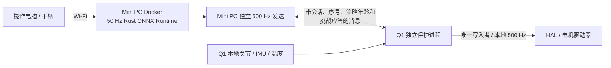

# Q1 本体侧保护扩展与当前接入进度

当前部署已更新：Q1本地持续推理与Web服务、Mini PC Docker转发入口，真实任务操作流程已通过。[当前控制台与操作说明](2026-11-07-q1-onboard-console.md)。以下包含此前架构／评估阶段记录。

日期：2026-11-07。本文补充原 Rust 接入方案。用户已经确认吊装状态，授权真实 ROS2 接入，提供了 Q1 的 SSH 登录方式，并要求保护程序先在本项目构建、最后部署到本体。保护程序已在项目内交叉构建、校验并部署，已做真实左肘小范围接管测试。当前因 5 ms 调度时限超限而锁止，不能描述为完成全身控制验收。

## 原理

模型只产生候选目标，不能直接绕过保护进程写 HAL。Mini PC 的推理线程和发送线程分开；Q1 的保护进程与模型、网页、Wi-Fi 接收分开计时。每次正常执行都需要有效会话、足够新的策略结果和本体反馈。

保护进程检查：完整且有限的 22 关节目标、校准后的硬件范围、目标跳变、实测跟踪误差、机身姿态、温度、命令模式以及运行许可。正常目标按策略周期更新，在 500 Hz 输出周期内有限保持。不得通过重发刷新原始策略年龄。

## 网络故障处理

单独在 Mini PC 发保护指令不能覆盖 Wi-Fi 中断；因此最后的超时判断和 HAL 写入应位于 Q1。保护进程使用本体的单调时钟记录最后有效消息，不直接比较两个机器的 monotonic 数值。

保护进程定期生成有时限的挑战标识。Mini PC 的消息必须回显有效标识，并携带真实的策略序号／生成年龄；积压旧包即使恢复到达，也不能无限续期。重复策略序号只允许在该策略的原有有效期内保持，不因新的发送序号或心跳而变成新策略。

跨机源采样时间和本地接收时间分开记录。挑战应答用于约束控制消息时效，不能掩盖老旧的传感器输入。需要同时测量 Wi-Fi 往返时间、最新实际观测年龄和两侧调度抖动，再确定超时预算。

## 故障后的目标

故障锁存后拒绝新的行走／舞蹈指令，不自动重连续播。保护输出的具体阶段需要在吊装下验证：限制位置误差和目标速度，降低刚度，进入有界阻尼／限力状态，并报告本体仍处于何种控制模式。

HAL 消息提供 stiffness/damping/effort 字段，但不代表已经确认驱动器的电流限幅。PD 估算和软件目标限制属于软保护，不能冒充驱动器内部硬限流。刚度、阻尼、持续时间、姿态和温度阈值需要用小范围实测确定，不把训练增益直接当作已验证的故障参数。

阻尼保护不保证动态站立，不具备学习策略的平衡能力；某些故障可能导致机器人失去支撑。因此首次测试依赖吊具，正常落地测试仍需要独立急停与驱动器自身保护。保护进程／Q1 操作系统本身崩溃或本体断电也不属于该用户态进程可以完全覆盖的故障。

## 构建和部署顺序

1. 在本项目实现保护协议、Q1 本体端和 Mini PC 适配端，固定协议版本与配置身份。
2. 在项目构建环境交叉编译 Linux ARM64 产物；检查动态依赖、ROS2 Humble ABI、厂商消息布局、校验和和可重定位启动入口。
3. 完成本地数值和程序检查，保存可复现构建清单。用户要求不进行 Mock 操作；实际 SDK 接入验证使用真实 Q1，只读与执行阶段分别标识。
4. 最后通过 SSH/SFTP 将项目内已构建产物放到 Q1 独立目录，先运行只读诊断。未经明确的部署步骤不修改原厂系统服务或覆盖其文件。
5. 吊装下先测同姿态低幅度控制和故障响应，再做断开策略、网络断流、超期／重放消息、进程退出等故障实验。仅断开 ROS/程序链路，不改动 SSH 或整机网络配置来制造故障。
6. 保护链路与观测／关节映射确认后，进入真实初始姿态、脚部承重站立和小幅动作。不能把双脚悬空的策略表现当成落地站立验收。

## 本轮已经完成的接入工作

| 项目 | 证据与状态 |
|---|---|
| 真实 ROS2 图 | 已发现并读取 `/aima/hal/joint/state` 全 22 关节及 `/aima/hal/imu/state`；HAL 全身命令有订阅端 |
| 原厂 MC 查询 | `GetMcAction` 出现在图中，但实际服务可用性查询未成功；不能据此确认 MC 工作状态 |
| 本体运行环境 | aarch64、Ubuntu 22.04.5、6.1.141-rk3576；已在独立版本目录部署，不覆盖原厂服务 |
| ONNX | 已从固定 JIT 导出，68 组真实 golden 样本通过；最大动作绝对误差约 1.073e-6 |
| Rust 在线实现 | 已构建 Rust ORT、1376D 观测、参考读取、Unix IPC、真实 ROS2 读取、独立 500 Hz 调度和控制台原型 |
| 真实只读验证 | 30 s、292 次 HTTP 状态采样；完整关节、有效 IMU、真实观测推理工作；没有发布电机命令 |
| Rust ORT 数值及性能 | 68 组样本通过；本次报告 P50 2.162 ms、P99 2.610 ms、最大 4.727 ms |
| 500 Hz | 报告时调度频率约 499.996 Hz；累计最长调度间隔约 12.514 ms，尚未满足原方案的最大 5 ms 目标；这不是本体收包或执行频率验收 |
| 实时观测 | 发现源时间年龄有较大波动，样本曾落后约 1.5 s；检查曾记录本地接收较新但源采样仍老旧。保护检查会拒绝这些数据，不放宽阈值掩盖问题 |
| 机身速度 | `/odom` 只读查询没有实际发布数据，连续舞蹈入场的根速度判据仍需补齐 |
| Q1 本体保护进程 | 已完成 ARM64 构建、依赖闭包验证与部署；真实策略过期和调度超限均触发锁止。完整同姿态保持验收尚未通过 |
| 动作质量 | 当前22100仍未完成闭环站立、行走和完整舞蹈验收；未把数值一致性写成动作合格 |

真实连机报告位于 `q1/rust/reports/supermimic-live.json`；ONNX 发布包位于 `q1/artifacts/supermimic/iter22100-onnx/`。当前控制台在 Mini PC 的 8768 端口提供真实只读状态；操作口令由部署脚本单独生成，不嵌入页面或记录到日志。

当前实现仍处于联调阶段，不能将模板中的确认字段手动改为 true 来代替本体保护、校准与闭环验证。没有执行 Git 提交。

## 2026-11-07 实施补充

现场最新确认：双脚接地承重，吊带负责防倒。生产运行镜像为 `embodied-q1:supermimic`；Mini PC Docker 运行控制台和鉴权代理，Q1 本体运行本地 ROS2/HAL 保护器。保护协议为 v3，使用 HMAC-SHA256、配置 SHA256、随机挑战、保守的双向时钟区间映射和严格递增策略序号。两端原始采样时间不被网络接收时间覆盖。

本次只允许 `air_hold` 调试配置：HAL 命令数组仅含 `left_elbow_joint`，Kp=2、Kd=0.1；故障时捕获姿态，Kp=0.5、Kd=0.1。其他 21 关节不下发命令。这个边界不是模型硬件校准，也不证明 HAL 固件在保护进程自身退出后的行为。

反馈转发改为 2 ms 周期，控制共享区使用 Linux 优先级继承；实测线程为 SCHED_FIFO 20、绑定 CPU7。Q1 内核配置为 `CONFIG_PREEMPT_VOLUNTARY=y`、`CONFIG_HZ=250`，并非已验证的硬实时执行环境。实测仍出现 >5 ms 间隔，严格保护会锁存；没有放宽阈值或自动恢复。

当前记录和限制以 [部署与测试记录](2026-11-07-supermimic-deployment-results.md) 为准。此前表中的 30 秒只读测试属于早期阶段，当前本体正在输出单左肘故障保持，不能称当前所有执行器写入为零。用户随后授权评估在 Q1 上运行 ONNX；该评估仅做数值和性能测量，未授权结果直接放行运动。
