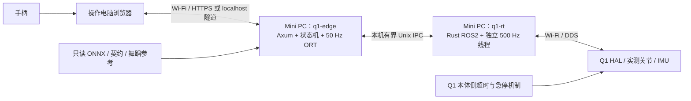
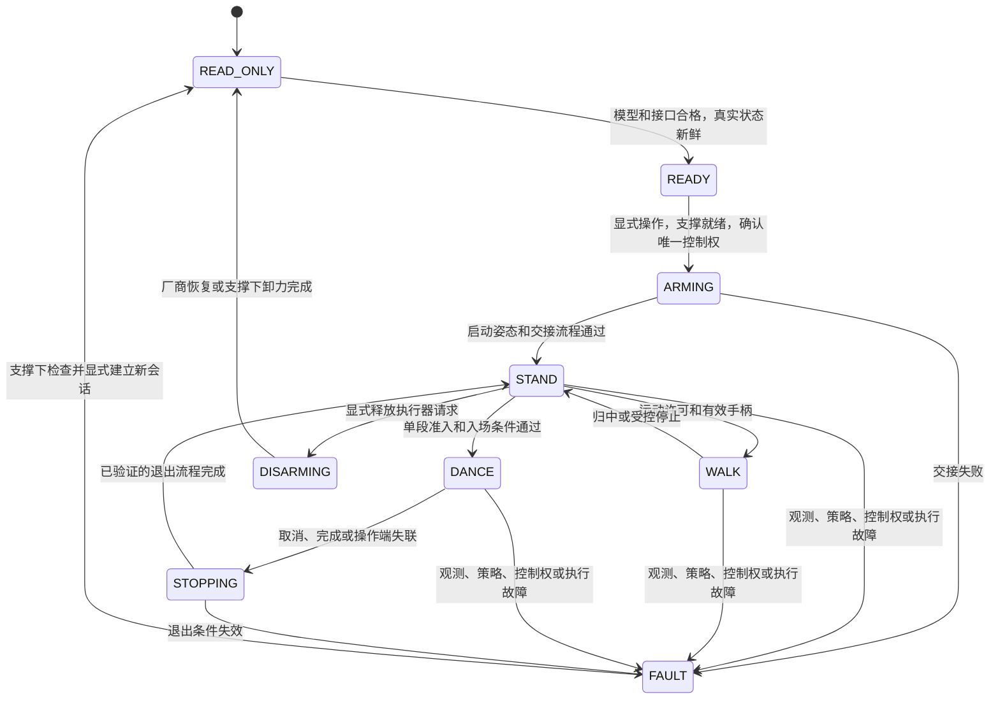

# Q1 SuperMimic 接入设计与实施方案

日期：2026-11-07（北京时间）。状态：方案已批准，已实施 Rust/ORT、ARM64 本体保护及 Docker 联调；运控验收尚未通过。

实施更新：用户已授权按方案开发并直接连接真实本体，确认已经吊装，要求不进行 Mock 操作。下文“本轮只交付方案”指最初的方案交付阶段；当前实现进度、真实连机证据和新增本体侧保护设计记录在 [Q1 本体侧保护扩展与当前接入进度](2026-11-07-q1-onboard-guard-design.md)。本体侧程序已经先在项目交叉构建、验证，再部署到 Q1。真实验收结果见 [部署与测试记录](2026-11-07-supermimic-deployment-results.md)。

设计主线（本体保护扩展后的部署以扩展文档为准）：两个 Rust 进程分别负责控制台／50 Hz ONNX 推理与 Rust ROS2／500 Hz 发送；按用户确认的全 Wi-Fi 拓扑评估，正常目标采用有时限的零阶保持。先完成离线数值、接口、时序和闭环验证，再按实际本体能力逐步接管。建议先审阅第 3 节架构、第 6 节停止语义、第 10 节实施阶段和第 13 节接口缺口。

## 1. 本轮交付与已确认需求

最初阶段只交付方案；后续用户已授权完整开发与吊装真机逐级测试。用户已明确确认：Mini PC 通过 Wi-Fi 连接 Q1，操作电脑也通过 Wi-Fi 连接 Mini PC；Q1 当前处于高级开发模式。后续实现使用 Rust 后端、Rust ROS2 SDK 和 ONNX Runtime，在 Mini PC 的 Docker 中运行，支持手柄与舞蹈。策略结果在有效期内保持，低层以 500 Hz 重发。不得使用 superpowers，不执行 Git 提交。

模型包固定为：

```text
/home/kyokagong/models/supermimic/q1/q1_unified_6144_iter22100_20261107
```

模型包指南第 10 节中的“真机不用 Docker”来自之前的部署约束；本方案按本次用户指令改为 Docker。其模型输入、动作映射和时钟契约继续保留。

当前工作区存在已有的 Python、Rust、UI 和文档未提交修改。后续以当前文件为基线增量开发，不回退或覆盖这些修改。这条仅描述最初文档交付阶段。当前授权范围包括真实连机与逐级执行；本次已经进行固定低增益左肘保持测试，尚未向双腿下发策略指令。

## 2. 已核实的事实与未解决的接口

### 2.1 交付物身份

本轮只读校验包内 `SHA256SUMS`，270 个条目全部匹配；另外核对了关键文件摘要、NPZ 数组形状及参考姿态。没有重跑模型推理或闭环实验。

| 项目 | 已核实内容 |
|---|---|
| checkpoint | iteration 22100，SHA256 `8f0667b501cf56b12218c8a44bbd84765db3b227c33ec67339882812e4534c25` |
| 现有推理模型 | `model/policy.jit`，SHA256 `8b9ba29c505501fbf3dfafd7cc8ceb19f331c030e8c6532a8d4f6e39cb6fddba` |
| 部署契约 | `deployment_contract.json`，SHA256 `7fd20d20fc889878866a6140de969d95970a6d8d592977f6b8a38f8e920bcdd2` |
| ONNX | 包内尚未提供，必须导出并独立验证 |
| 网络 | 单 actor、共享 decoder、两个条件编码器；约 867 万参数；非 RNN |
| 输入／输出 | float32 `[1,1376]` → float32 `[1,22]` |
| 时钟 | 策略 50 Hz，训练物理 500 Hz，decimation=10 |
| golden 向量 | 17 个场景 × 4 步 = 68 组，覆盖速度、站立、8 舞蹈及 standing 模仿 |
| 舞蹈参考 | 8 条 LAFAN1 舞蹈 + 1 条 standing，已经转换到 50 Hz |
| 质量状态 | `snapshot.qualified=false`，`latest_snapshot_quality_not_evaluated=true` |
| Mini PC | 当前主机 `kyokagong-MINI-S`，x86_64，Intel N95；没有本模型的本机时延实测 |

这是正在训练的中间快照，不能把旧 iteration 20000 的测试、以前的 28k 模型或 JIT 数值一致性当作 22100 的动作验收。包内训练实际上采用 mjlab / RSL-RL PPO；部署按该统一模型契约实现，不能沿用原始世界模型训练产物的加载方式。

### 2.2 现有代码可复用范围

| 现有位置（相对 `q1/`） | 当前行为 | 本次设计 |
|---|---|---|
| `rust/src/ros.rs` | r2r + Humble/FastDDS；高层速度输出；循环含约 10 ms 调度 | 保留原厂 MC 路径，另建低层发送进程 |
| `rust/src/sdk.rs` | 10 个上肢关节；依赖 `BIPED_WALK_RUN / RUNNING` 与 MC 仲裁 | 单独增加全身状态和 HAL 控制契约 |
| `rust/src/core.rs` | 手柄校准、RB 锁定使能、输入超时；原厂速度最小非零值 0.2 | 复用输入校验，分开控制器状态机和限速规则 |
| `rust/src/server.rs` | Axum HTTP、同源检查、操作 token、静态页面嵌入二进制 | 增加能力描述、舞蹈 API、运行状态；补全局域网操作身份 |
| `q1_edge/web/` | 10 关节视图，手柄与 Pico，SuperMimic 禁用 | 增加全身反馈、舞蹈工作区，按能力显示 |
| `rust/Dockerfile`、`scripts/build-rust.sh` | Rust 1.90.0，r2r 0.9.7，ROS2 Humble，锁定镜像 | 增加 ORT、第二个 Rust 二进制与部署配置 |

现有 Rust ROS 订阅只提取关节 position，不能直接满足本模型的 22 关节 position + velocity。现有 `Backend::stop` 的原厂零速／释放源逻辑也不能直接复用为 HAL 停止。

### 2.3 用户给出的 ROS 图不等于全身接入已具备

目前可见 `/aima/hal/joint/state`、两个 MC 命令话题，以及 `GetMcAction`、`SetMcAction`、`GetCurrentInputSource`、`SetMcInputSource`。话题／服务出现在图里只能证明某些端点被发现；不能证明 MC 正常平衡、HAL 控制权已释放或命令被硬件执行。端点也可能来自现有 `edge_q1` 客户端。

用户指定的 `vendor/primebot_sdk` 已核对：固定上游提交 `7310314eee058323a2c15ab1f4f947df4112573e`，包含完整消息包、三个参考示例和使用声明，不含完整的上游接口手册。

| 能力 | 本地依据 | 下一步需要的证据 |
|---|---|---|
| 全身关节反馈 | `JointStateArray`；元素包含 name/position/velocity/effort/温度等 | 真机完整 22 关节、单位、实际频率、时间戳语义、QoS |
| 全身命令结构 | `JointCommandArray`；元素包含 name/position/velocity/effort/stiffness/damping | 当前固件实际订阅的话题、控制模式、500 Hz 与超时约定 |
| MC 上肢命令 | `McCustomJointCommand` 注释明确为上肢；示例要求保留 MC | 不能作为全身 HAL 替代接口 |
| pelvis 姿态、角速度 | 本地消息及示例中未找到对应 IMU 接口定义 | 厂商接口／设备数据源、坐标系、安装旋转、单位、采样时间 |
| MC/HAL 交接 | 使用声明要求低层控制前关闭高层运控 | 当前固件支持的关闭、确认、恢复流程及硬件急停路径 |
| 低层断联处理 | MC 输入源有 timeout 字段 | HAL 的本体侧 watchdog；MC 的 1000 ms 租约不能当作 HAL 保证 |

上游此前示例使用过 `/aima/hal/joint/command`，这里只将其作为待现场核对的候选；本轮没有证明当前固件开放它。不要为了让程序启动而改发 MC 上肢话题，也不能用零 IMU、参考姿态或不完整关节反馈代替实测值。

## 3. 总体架构与 Wi-Fi 边界



推荐在同一 Mini PC 上部署两个 Rust 进程，由 Docker Compose 管理，共享 Unix socket 卷：

- `q1-edge`：HTTP、手柄输入、舞蹈管理、50 Hz 推理、非实时日志。策略线程不持有 HTTP 状态锁执行推理。
- `q1-rt`：直接用 Rust/r2r 对接 SDK，接收真实状态、维护执行许可，独立 500 Hz 发送与看门狗。没有 Python SDK 服务中转。
- SDK 的服务发现／查询与反馈接收不能阻塞 2 ms 发送线程。需要以 r2r 的实际线程约束做最小原型验证，不使用不受保证的跨线程裸指针。

选择独立进程，是为了在 ORT 阻塞、HTTP 卡顿、策略进程崩溃时仍可检测过期目标。它不能覆盖 Mini PC 断电、`q1-rt` 被强杀或 Mini PC→Q1 Wi-Fi 中断；这些必须由本体 watchdog 和独立急停处理。

**500 Hz 分三级验收：**发送线程每 2 ms 运行；DDS publish 实际提交；Q1 侧实际接收／执行。Mini PC 的计数器达到 500 Hz，只能证明第一或第二级。标准 Linux、Docker 和 Wi-Fi 不构成硬实时保证。

本方案按全无线实现和评估；如果实测无线延迟／丢包不满足闭环预算，真机阶段不放行。后续可选择将 `q1-rt` 迁至本体或改变网络，但这不是本轮已接受的部署替换方案，需另行确认。

## 4. ONNX 发布与模型契约

### 4.1 导出与版本固定

1. 原始包只读；优先从已验证的 `policy.jit` 导出单输入、单输出 FP32 ONNX，输入名 `obs`、输出名 `actions`，固定 batch=1。
2. 若导出器不支持该 TorchScript 路径，才使用包内 `_Q1UnifiedExport` 与匹配环境从 checkpoint 严格重建。不得绕过训练身份、归一化或模型哈希检查。
3. 必须保留两个条件分支及 `mode > 0.5` 选择，防止示例输入导致其中一支被固化；保留内部归一化和确定性输出。首版不做 INT8、FP16、网络裁剪或分支改写。
4. Python/Torch 仅用于离线导出、对照和仿真工具；正式在线推理由 Rust 调 ONNX Runtime CPU EP 完成。
5. Rust 采用 `ort` 绑定；锁定 crate、ORT 动态库版本及 SHA、opset、导出器版本、Cargo.lock、镜像摘要。当前可调研候选为 `ort 2.0.0-rc.15`／ORT 1.31；它尚未在项目 Rust 1.90.0 与 Humble 镜像中构建验证，不能将“最新”直接作为兼容性结论。实施阶段先验证 MSRV、ABI 和 CPU 指令集再固定版本。[绑定维护方文档](https://docs.rs/ort/2.0.0-rc.15/ort/)

新增独立发布目录，例如 `q1/artifacts/supermimic/iter22100-onnx/`（不改写原模型目录），包含 `policy.onnx`、原始身份副本、部署契约、参考目录、导出清单、golden 对照和性能报告。运行中禁止热换权重；换模型时先结束执行会话，再重做身份和就绪检查。

### 4.2 数值验证

- 对 68 组 golden 分别执行固定 batch=1 推理；检查 raw action 与映射后 target，沿用包内 `rtol=3e-4, atol=3e-5`，记录每个场景和最大误差。不得通过放宽容差隐藏导出错误。
- 同时比较 JIT、Python ORT 和 Rust ORT，防止只验证 Python 推理而漏掉 Rust 的张量布局／动态库问题。
- 补充两模式交替、阈值附近、非零 command/phase、连续历史等有效输入。NaN/Inf 在运行入口直接拒绝，不依赖网络内部屏蔽。
- 68 组向量只验证已有输入到输出的一致性；还需要“原始 q/qd/IMU/参考 → Rust 1376D 输入”的独立对照夹具，不能省略观测组装测试。

### 4.3 输入、历史与坐标

| 输入切片 | 内容 |
|---|---|
| `0..780` | 10 × 78 本体历史，旧→新，帧优先 |
| `780` | mode：站立／速度 0，舞蹈 1 |
| `781..784` | 身体坐标 `vx,vy,wz` |
| `784..786` | 相位 sin/cos；站立为 0,0 |
| `786..1376` | 当前参考帧对应的 590D goal；速度模式全零 |

单帧严格为：`[q-q_home+b, qd, omega_body, Rᵀ·(0,0,-1), previous_applied_raw, relative_orientation_6d]`，维度为 `22+22+3+3+22+6=78`。

- R 为 pelvis 局部→世界；姿态与角速度先从厂商 IMU 坐标转换到 pelvis。若角速度本已在身体坐标，不再重复乘 Rᵀ；只提供原始加速度／陀螺时，需要额外姿态估计与验证，不能伪造姿态。
- 舞蹈相对姿态为 `RᵀR_ref[f]`；速度模式为 `Rᵀyaw(R)`。复现训练 `yaw_mat` 的竖直退化分支。
- 6D 编码按前两列逐行展开 `[M00,M01,M10,M11,M20,M21]`；单位旋转为 `[1,0,0,1,0,0]`。四元数输入约定显式记录，不混用 xyzw/wxyz。
- qd 不乘 0.1；重力方向不乘 9.81；不重复归一化；不加入 critic 的 6 维特权输入。
- 初次用第一帧完整真实观测填满 10 格；之后每 20 ms 更新一次，跨度 180 ms。模式切换保留历史；故障后重新初始化只属于新的显式会话，且必须满足物理起始状态条件。
- SDK→模型映射使用关节名，强制 22 个名称唯一、完整、值有限，不能使用消息数组下标猜顺序。可配置 `q_native=s*(q_sdk-z)`、`qd_native=s*qd_sdk`，s 为已标定的 ±1，z 为已确认零点；输出严格逆映射。encoder_bias 与 SDK 零偏分开表示，部署默认不注入训练随机噪声。
- 原始采样时间、接收单调时间和序号同时保留；确认 `header.stamp` 与 `meas_stamp` 的固件语义。跨机时钟不同步时不能把接收时间改写成采样时间来掩盖旧数据。
- 校验四元数范数、旋转有效性和传感器质量标志；有限但错误的姿态也不能直接用于控制。记录姿态估计启动／重置造成的 yaw 跳变；模式切换不能把这种跳变当成正常参考变化。

### 4.4 输出和上一动作

```text
applied_raw = clamp(raw, -20, +20)
q_target_native = q_home + 0.25 * applied_raw - encoder_bias
q_target_sdk = z + s * q_target_native
```

训练的 ±20 动作裁剪可能对应 ±5 rad 偏移，不能替代硬件限位。22 关节 home、仿真 kp/kd、模型范围从契约读取；实际方向、限位、增益、速度、扭矩和温度边界另建固件／本体绑定的校准配置。不能把仿真增益直接当成厂商推荐值。

`velocity/effort/stiffness/damping` 的发送语义要先与固件确认。若确认是目标位置 PD，首版按训练匹配的速度／前馈语义配置，不能把网络的 raw action 当作扭矩。

只有被执行桥接受并开始发送的目标才推进 `previous_applied_raw`；记录 bridge 接受序号，不把被丢弃或过期推理结果写成已执行动作。这个确认只表示桥已采用，不冒充电机到达目标。新策略运行前核对上一结果是否被采用；未采用则不盲目推进闭环。

首版正常路径使用零阶保持，不额外平滑。硬件限位、目标跳变、非有限值触发明确故障，不能静默裁剪后继续报告原始动作已正常执行；若后续增加限幅／滤波，必须定义对应上一动作语义并重做闭环验证。

## 5. 50 Hz 推理与 500 Hz 输出

### 5.1 独立时钟与有界保持

| 任务 | 目标频率 | 执行位置／约束 |
|---|---:|---|
| 浏览器输入心跳 | 20 Hz | 保留现有采样方式，只发送最新输入，不驱动策略时钟 |
| HTTP 状态刷新 | 5–10 Hz | 读取快照，不阻塞控制线程 |
| 关节／IMU 接收 | 厂商实际频率 | q1-rt ROS worker，保留源时间和序号 |
| 观测历史、相位、舞蹈帧、ORT | 50 Hz | q1-edge 专用策略线程，20 ms 绝对周期 |
| 全身命令发送 | 500 Hz | q1-rt 专用线程，2 ms 绝对周期 |
| 日志落盘 | 异步 | 有界队列；控制线程不等待磁盘或浏览器 |

一次 50 Hz 策略输出通常重发约 10 次；不是将一个目标永久重发。高频帧有新的传输 sequence/stamp，但目标的 `generated_at`、观测采样时间和 `policy_seq` 保持原值，避免“重发刷新时间戳”掩盖过期结果。

相位为 `episode_policy_step * 2π * 1.5 * 0.02`；零速时输入 sin/cos=0,0，但 episode 时钟继续。速度命令改变不重置相位。舞蹈的 `reference_frame` 只按有效 50 Hz 策略周期推进，重复 HTTP 请求和 500 Hz 重发不推进、不清零。

使用单调时钟和绝对 deadline；超时后不密集补发历史命令，不伪造缺失的历史观测，不把舞蹈跳到墙钟对应的未来帧。推理结果携带原始 observation/mode epoch，迟到或已切模式的结果丢弃。一次 deadline miss 可在经过仿真验证的短保持预算内使用上一有效目标；持续错过 20 ms 截止时间进入故障，不将长期 25 Hz 推理伪装成训练时的 50 Hz。

用户允许“模型频率低于 500 Hz、保持上一状态输出”，与本模型原有 50→500 Hz 设计一致；若 N95 连 50 Hz 都无法稳定达到，需要优化或另外评估低策略频率，不能仅靠重发宣布已满足闭环要求。

### 5.2 IPC 与实时线程

本机 IPC 初选非阻塞 Unix `SOCK_SEQPACKET`，使用有版本的固定布局消息与有界缓冲。实际采用的数据包括：

- `SensorSnapshot`：完整 22 关节、姿态／角速度、源／接收时间、序号、质量标志。
- `PolicyTarget`：session、mode epoch、policy seq、生成／观测时间、22D raw 与 SDK target、有效期、配置身份、运动类别和操作输入原始租期。
- `BridgeStatus`：接受／发送的 policy seq、最后 tx seq、状态年龄、控制权、故障、周期统计。
- `ControlIntent`：运动许可、模式、受控停止或退出请求；与普通目标消息有清晰优先级。

IPC 只保留最新完整状态／目标，限制每周期 drain 数，拒绝旧 session、重放序号、不完整消息和非有限值。单消费者读写所有权固定；不用会阻塞实时线程的共享大锁。IPC 断开立即撤销会话，不因进程自动重启而恢复执行。

操作租期只由有效的新操作者输入续期，策略计算、传输重发、HTTP 状态轮询都不能续期。q1-rt 独立检查租期：到期后不继续接受旧行走／舞蹈目标，要求健康策略进入已验证的受控停止流程；流程在其限定时间内不能提供有效目标时转 FAULT。停止过渡期间的目标由专门状态及截止时间约束，不能用新时间戳无限延长。这样可覆盖“HTTP／输入处理已停，但推理线程仍不断计算旧非零命令”的遗漏。

500 Hz 线程不执行 ORT、服务等待、参考解压、文件读取、JSON 序列化或同步日志。消息模板预分配；r2r/rcl/DDS 内部的分配和 publish 阻塞需要实际分析，不能宣称预分配 Rust 数组就实现了全链路零分配。若底层库行为达不到预算，先改进 Rust 绑定／调度与中间件配置再验收。

N95 上先比较 ORT intra-op=1/2 与顺序执行；控制、ROS 接收与推理按实测决定 CPU 亲和性。ORT 默认线程池可能占用多个核心，spinning 也会增加 CPU 占用，应显式配置和压测。[ONNX Runtime 线程管理](https://onnxruntime.ai/docs/performance/tune-performance/threading.html)

实时优先级、内存锁定和 CPU 绑定是后续实测优化项；只有需要时才给容器 `SYS_NICE`／`IPC_LOCK` 等最小权限，不默认 `--privileged`。标准内核下仍按实测时延报告，不承诺硬实时。

### 5.3 时间预算与测量

以下是待验证的工程目标，不是已通过结果，也不是厂商给定安全阈值：

| 指标 | 初始目标／处理方式 |
|---|---|
| 单次 ORT 推理 | warm-up 后 P99 < 10 ms；完整策略工作 < 20 ms |
| 500 Hz 发送 | 每 60 s 窗口平均 498–502 Hz；P99 间隔 ≤3 ms、最大 ≤5 ms |
| Q1 接收间隔 | 必须另行测量；先以相同频率／间隔目标评估，最终不宽于厂商和闭环验证预算 |
| 目标年龄 | 离线故障注入先测 20/40/60 ms；真实启用值由闭环结果和厂商约定确定，不能无限保持 |
| 关节／IMU 陈旧、跨传感器时间差 | 根据实际发布频率、时钟精度和仿真延迟容限分别设定，不沿用高层 250 ms |
| 操作端输入失联 | 先沿用 250 ms 作为 UI 运动许可租期；与传感器和 HAL 超时分开 |
| 持续负载 | 至少 30 min，包含 UI 活动、ORT、日志、CPU／内存压力和真实 Wi-Fi 环境 |

记录 P50/P95/P99/max、deadline miss、最长连续保持、接收丢失／乱序／重复、推理年龄、采样→推理→发送→接收延迟。发送和接收间隔可分别用各自单调时钟；跨机单向延迟必须同时报告时钟同步误差，否则只报告 RTT 与各端间隔。

同一 AP 上操作电脑与 Mini PC、Mini PC 与 Q1 都占用无线资源，需测试 UI 与 DDS 同时活跃的状态。DDS 配置绑定正确网卡／域号并核查发现机制；深队列和 Reliable 重传可能造成旧指令排队。命令可靠性、history depth、lifespan 和可用 watchdog 按固件契约选取，不能单方面切 BestEffort 就宣称问题解决。

## 6. 控制权、停止与故障状态机

### 6.1 状态和前置条件



所有执行状态都适用独立硬件急停；图中的正常转移不是故障的唯一入口。启动、重启、自动重连一律只读。高级模式仅表示开发权限，不能自动推断原厂 MC 已停止。

`READY` 要求模型身份／数值对照通过、硬件映射有效、实际 22 关节和 IMU 新鲜、停止契约已确认；`ARMING` 还需要排他执行权和已经验证的物理初始化路径。初次不实现从地面躺姿自主起立：先在支撑条件下进入模型允许的姿态，再初始化真实历史。接管第一帧不能直接从任意关节角跳到 home。

MC 的 `GetCurrentInputSource` 和 `SetMcInputSource` 仅在其契约覆盖范围内使用，不能当作 HAL 的独占锁。关闭 MC 的具体命令暂不编造；先取得厂商流程，再做显式交接状态和验证。原厂 MC、旧 Python/Rust 程序、Pico 与 SuperMimic 不能同时写同一关节。

Mini PC 使用共享宿主锁限制本项目多实例；另外检查 DDS 发布者身份及厂商执行所有权，防止另一台机器或原厂模块仍在写。发布者数量本身也不等于已获得固件控制权。

### 6.2 不同“停止”不能混为一谈

| 事件 | 处理语义 |
|---|---|
| 行走时摇杆回中／A | mode0，command/phase 归零，策略与 500 Hz 发送继续 |
| B/Esc、RB 取消运动许可 | 取消行走／舞蹈任务；健康闭环使用已验证的受控回站流程，不直接停发或卸力 |
| 浏览器失焦、手柄断开、输入租期到期 | 本地自主撤销运动许可并取消队列；健康情况下回站；重连不自动续舞／续走 |
| 观测失效、ORT 失败、旧目标、控制权丢失、异常姿态／温度／目标 | 锁存 FAULT，执行厂商确认的低层故障流程，不依赖“模型零速”补救坏观测 |
| 用户要求卸力或切回原厂 | 独立 DISARMING 流程；确认支撑／接管方和厂商状态，禁止突然启用另一个控制器 |
| q1-edge 崩溃／IPC 断开 | q1-rt 看门狗执行已验证流程；不无限重发最后目标 |
| q1-rt 强杀、容器全停、Mini PC 断电、到 Q1 的网络断开 | 依赖 Q1 本体 watchdog／独立急停；Mini PC 软件无法保证最后保护帧送达 |

故障策略不能先写成“统一发零扭矩”或“统一加阻尼”再假定安全；具体值、持续时间、控制模式与恢复方法必须来自本体契约并在支撑下验证。该信息缺失时，软件可完成离线和只读接入，但不能放行真机执行。

UI 分别显示“运动许可”和“执行器／站立控制仍在运行”。取消运动许可不等于电机已关闭；网页的停止按钮不标作独立硬件急停。SIGTERM 先请求有界的退出流程并报告结果，不能仅凭进程退出码判定机器人已安全接管。

温度、供电和电机错误也属于执行状态判断。SDK 关节状态有温度等字段，具体单位和阈值须核对；当前 ROS 图没有 BMS 数据，不能在 UI 默认显示电量正常。需要本体自身低电保护的确认和可获得的电源状态，无法在线获取的项目在初次支撑测试中按明确的现场检查条件记录。

## 7. 手柄与舞蹈设计

### 7.1 手柄映射

沿用现有标准手柄识别、序号、全释放／回中校准和同帧停止优先。保留 RB 长按 1 s 切换运动许可的习惯，每次长按只触发一次；在高级控制器下取消许可走受控回站，不能沿用原厂后端“停止后释放源”的实现。

| 输入 | SuperMimic 行为 |
|---|---|
| Back | 未执行或安全站立状态下校准手柄中位，不修改硬件关节零点 |
| Start／RB 长按 | 条件满足时显式请求使能；首次进入 STAND |
| A | 请求站立／结束当前运动，健康闭环继续 |
| X | STAND → WALK；左摇杆前后／横移，右摇杆水平转向 |
| Y | 请求播放 UI 当前选中且已允许的舞蹈；条件不符时给出原因 |
| B／Esc | 受控停止并清空舞蹈队列，优先于所有开始事件 |

模型 command 范围为 vx `[-0.25,0.35]`、vy `[-0.18,0.18]` m/s、wz `[-0.6,0.6]` rad/s。前后范围不对称；必须移除原厂 SDK 的 `min_nonzero=0.2` 规则。死区外重映射和速度上限按 SuperMimic 配置，首次真机上限还需更小的已验证运行范围，不能直接将训练范围当成安全范围。

模型训练非零采样下限为 0.04/0.04/0.08；它不是强制输出最小值，也不证明任意小输入可以可靠起步。原厂 MC 后端继续使用其独立限速配置。

舞蹈期间摇杆不叠加到目标动作；需要先取消舞蹈、回站再显式进入 WALK。Pico 在全身策略期间不可用，因为模型没有 Pico 条件分支；不能旁路覆盖上肢。

### 7.2 参考加载、播放与切换

- 目录只从固定 `dance_catalog.json` 生成，使用受限 clip ID，不接受任意文件路径。校验 hash、role、N/shape/dtype、有限值、20 ms 时间轴和包内路径；限制解压体积。standing 独立作为参考诊断项，不列为第九支舞。
- Rust 在执行前加载所需 NPZ 并缓存 `goal_590`、`root_R` 及诊断所需字段；不在实时线程解压。`time_s` 是 f64，目标和旋转是 f32；无需再次做 30→50 Hz 插值。
- 每段开始 f=0；本体相对姿态和 goal 必须使用同一个 f。完成当前有效策略周期后推进到下一帧，末端按数据协议处理，禁止越界或瞬移到下一支舞。
- UI 支持选段、加入／移除队列、开始、取消、查看进度；首版不提供跳转进度、倍速和“冻结在半蹲姿态后任意续播”。取消或断联后必须重新入场，不从旧的中间帧自动恢复。
- API 使用 session epoch、严格序号和 request_id 幂等键；重复开始／网络重试不重置 f、不重复入队。开始操作不持久化为重启后自动任务。
- 一段完成先经退出流程到 STAND，重新满足准入条件才开始下一段；队列开始需要显式许可。

训练 `transitions_trained=false`，当前参考也未按实际入场 yaw 自动重锚定。首版必须验证参考起始姿态／航向和退出过程，不用修改渲染画面、清空历史或物理 reset 隐藏跳变。将来增加 yaw 重锚定须同步修改相关参考协议并重新闭环验证。

现有播放器的入舞条件是连续 25 个策略步满足 `|vx|,|vy|<0.08 m/s`、`|wz|<0.2 rad/s`、`upright>0.95`。其中根线速度是仿真可得、当前 actor 又不直接需要的额外量。真机必须找到可靠的速度估计，或设计并验证接触／运动学的替代准入判据；不能把“摇杆为零”当成“已经站稳”。没有证据时禁用自动入舞和连续队列。

### 7.3 八条舞蹈的当前边界

本轮从当前包 `root_R[:,2,2]` 计算 `acos(clamp(value,-1,1))`，得到参考 pelvis 倾角（几何审查，不是实际模型动作结果）：

| ID | 时长（s） | 最大参考倾角 | 倾角 >80° 的 50 Hz 帧数 |
|---|---:|---:|---:|
| dance1_subject1 | 139.46 | 138.79° | 77 |
| dance1_subject2 | 139.46 | 53.03° | 0 |
| dance1_subject3 | 139.46 | 45.27° | 0 |
| dance2_subject1 | 233.66 | 89.55° | 24 |
| dance2_subject2 | 233.66 | 62.59° | 0 |
| dance2_subject3 | 233.66 | 66.47° | 0 |
| dance2_subject4 | 233.66 | 148.33° | 78 |
| dance2_subject5 | 233.66 | 42.48° | 0 |

八段都尚未完成当前快照的全段真机验收。三段含大倾角参考，不能默认为普通站立舞蹈。其余片段倾角较小也不代表已合格。UI 可展示全部数据，真实运行只允许通过逐段验收的范围；白名单初始为空。

跌倒检测与舞蹈自身倾斜需求可能冲突。首版不为通过高难动作而放宽保护阈值；动作段的接触、姿态、关节速度、扭矩和入退场必须一起评估。若需要裁剪片段，生成独立派生身份并重新验证端点，不静默修改原始参考或沿用原 SHA。

## 8. UI 与 API 改造

### 8.1 页面结构

复用现有页面与样式，不迁移前端框架。主页面分为下列区域：

```text
Q1 / SuperMimic 22100     只读/就绪/站立/行走/舞蹈/故障     操作端连接
运动许可    站立控制是否运行    当前任务    受控停止
────────────────────────────────────────────────────────────
手柄控制                         舞蹈
连接、映射、回中、校准             8 条目录、时长、可运行状态
目标 vx / vy / wz                当前段、进度、队列
站立 / 行走 / 已选舞蹈             开始 / 取消 / 清空队列
────────────────────────────────────────────────────────────
全身 22 关节：目标 / 实际          机身姿态、观测年龄、故障原因
详细诊断：推理耗时、发送/接收频率、最长保持、丢包、控制权、模型身份
```

默认突出操作状态和阻塞原因；完整模型 hash、QoS、观测布局、原始 ROS 错误放在诊断区。Pico 在 SuperMimic 模式下隐藏或禁用并解释原因，替换现有固定的“原厂 MC／10 DOF”文案。

明确区分 Mock、只读真机、已获得执行权；Mock 不是动力学仿真。实测速度接口不可用时显示“未提供”，不能用目标速度冒充反馈。500 Hz 显示“目标／实测发送／实测接收”，没有本体接收数据时显示未测。

按后端 `capabilities` 决定按钮、关节数量和输入源，不继续仅凭 `backend == ros2` 判断全部行为。所有物理后端都拒绝模拟滑杆帧，避免新增后端名称绕过原有保护。

### 8.2 API 契约（拟新增／扩展）

| 接口 | 内容 |
|---|---|
| `GET /api/state` | 保留现有兼容字段；增加 controller、execution_state、motion_permission、actuator_active、state_seq、model、sensors、timing、dance、blockers |
| `GET /api/capabilities` | 控制器、真实／模拟环境、22 关节能力、IMU、舞蹈可用范围、停止能力与限制 |
| `GET /api/dances` | 固定目录、角色、时长、身份、仿真／实机验收范围和不可运行原因 |
| `POST /api/input` | 保留最新帧和 compact ACK；携带 session/epoch/seq，服务端判定时效 |
| `POST /api/action` | 校准、请求执行、运动许可、站立、行走、受控停止；增加清晰的独立卸力／恢复操作 |
| `POST /api/dance/queue` | clip_id、入队／移除／清空、request_id；服务端校验 |
| `POST /api/dance/start`、`/cancel` | 幂等的任务请求，不直接覆盖关节，不代表任务已实际开始 |

HTTP 返回“请求接受”与实际状态转换分开；以 `request_id + state_seq + execution_state` 表示结果。页面不能收到 200 就显示“正在跳舞”。停止优先于同批开始指令，过期 ACK／旧页签／旧 session 不能恢复运动。

单操作者租约复用并完善现有 client_id/序号机制；网页重连、切后台、控制器变化均撤销旧 epoch。输入采用单在途请求、只发最新采样，不能在 Wi-Fi 恢复后重放缓存摇杆或舞蹈开始请求。

### 8.3 无线访问和浏览器手柄

局域网远程访问应提供受信任 HTTPS，或通过 SSH 转发使用操作电脑的 localhost。不能假定直接访问 `http://MiniPC-IP` 时所有浏览器的 Gamepad API 都可用；启动时检查 secure context、API 可用性、用户激活和标准映射，失败时给出明确原因。浏览器对安全上下文的限制有维护方说明。[Mozilla Gamepad 说明](https://hacks.mozilla.org/2020/07/securing-gamepad-api/)

当前页面将随机 token 嵌入首页，主要防同源伪造，不等于局域网操作员身份认证。无线开放控制前增加单独的配对／操作口令或受控隧道；口令不放 URL、不记日志，不把仅能浏览页面等同可获得运动租约。保留 Host 白名单、Origin 校验、请求大小和超时限制。

## 9. Docker、配置与发布

采用 Humble/jammy 构建与运行环境，兼容现有厂商消息库。宿主机的 glibc 版本不能替代镜像内 ABI 验证。模型和参考从宿主机只读挂载，运行时不自动下载、不扫描训练目录选择“最新”checkpoint。

拟新增 Compose 包含 `edge` 和 `rt` 两服务及可选的本地 HTTPS 入口。两进程可共用一个锁定构建产物镜像；rt 使用 `network_mode: host` 接入本机 Wi-Fi 的 DDS，Unix socket 使用受限共享卷，不需要为 IPC 暴露 TCP 端口或默认启用 host IPC。

配置分为四类，避免混用：

1. **模型契约**：只读，来自原包与 ONNX 导出清单，不允许现场随意改 input dim、home、scale、history 或频率。
2. **本体配置**：固件标识、22 关节映射、IMU 安装变换、限位／增益、真实话题／QoS、MC 交接、HAL watchdog 与恢复流程。
3. **运行配置**：model_dir、ROS_DOMAIN_ID、网卡、ORT 线程、2/20 ms 周期、经验证超时、CPU 设置、日志目录。
4. **操作配置**：手柄映射、已验证速度范围、可执行舞蹈段、局域网访问、操作者租期。

命令行拟保持 `--backend mock|ros2` 表示传输，新增 `--controller native-mc|supermimic` 表示控制算法，避免把算法和传输混成一个枚举。新增 SuperMimic 只读／影子推理入口；`--enable-hardware` 仍只是启动时允许后续显式使能，启动自身不发执行指令。具体参数名实施时固定并测试。

模型加载和 ORT warm-up 在只读状态完成；执行期间不得加载新参考、重建 Session 或修改参数。容器重启后不自动 ARM，不恢复任务队列。编排退出顺序、SIGTERM 与强杀分别验证；Docker 的 restart/healthcheck 不能替代本体故障保护。

CPU/内存限额和日志轮转必须留足推理及 ROS 余量，避免 CPU quota 节流造成 2 ms 周期漏发；模型预热后测常驻内存、缺页和热降频。输出可重定位发布包，记录二进制、ONNX、ORT、消息包、配置和镜像 hash。

## 10. 代码拆分与实施阶段

### 10.1 拟变更文件（尚未创建或修改实现）

| 路径（相对 `q1/`） | 职责 |
|---|---|
| `rust/src/supermimic/{contract,model,observation,reference}.rs` | 契约校验、ORT、1376D 组装、参考加载 |
| `rust/src/supermimic/{controller,scheduler,safety}.rs` | 模式与舞蹈、50 Hz 时钟、故障规则 |
| `rust/src/lowlevel/{types,ipc,ros,writer}.rs` | 全身状态、进程协议、Rust ROS 适配、500 Hz 输出 |
| `rust/src/bin/q1-rt.rs` | 独立低层进程 |
| `rust/src/{main,config,core,sdk,server}.rs` | 控制器选择、能力 API、配置与手柄策略分离 |
| `rust/Cargo.toml`、`Cargo.lock` | ORT、NPZ／数组读取、有界 IPC 和调度依赖；锁版本 |
| `q1_edge/web/{index.html,app.js,style.css}` | 舞蹈工作区、全身状态、控制器能力适配 |
| `scripts/export_supermimic_onnx.py` | 仅离线模型导出与 Python 对照 |
| `scripts/check_supermimic_*.py`、Rust 集成测试 | 原始观测夹具、离线 DDS、时序和闭环驱动 |
| `config/supermimic*.json` | 模型选择、未确认本体字段模板与测试 profile |
| `rust/Dockerfile`、`deploy/supermimic/` | ORT runtime、Compose、启动／诊断／日志配置 |
| `docs/supermimic-integration.md`、Rust README | 说明旧 28k 与新 22100 契约差异，新增运行／恢复手册 |

`Velocity::validate` 当前硬编码原厂上限，配置校验也限制原厂速度。两者必须按控制器拆分，不能只修改前端滑杆。`Backend` 需补充 capabilities、受控停止／执行器释放的语义；SuperMimic 不能继续依赖原厂 `Engine::ready()`。

保留 vendor 原字节与 provenance。若厂商后续提供新 IMU 消息，显式增加对应版本／依赖并记录差异，不能直接改写旧消息名称冒充新接口。

### 10.2 分阶段交付和依赖

| 阶段 | 具体交付 | 通过标准／后续依赖 |
|---|---|---|
| P0 接口与本体契约 | Rust 只读探测报告：节点／端点身份、类型、QoS、22 关节、姿态／角速度、频率、时钟；厂商交接与超时记录 | 接口不明则真机执行保持阻塞；不影响 P1/P2 离线开发 |
| P1 ONNX 发布 | 固定 ONNX + Rust ORT 加载 + 68 组逐样本对照 + N95 推理报告 | 两种模式、动作映射、身份与误差全部符合契约 |
| P2 离线控制核心 | 观测映射／历史／相位／上一动作、参考加载、模式与故障状态机 | 原始观测逐元素对照、拒绝坏数据和切换竞态测试通过 |
| P3 Rust 500 Hz 桥 | 独立 q1-rt、IPC、真实 r2r 消息、模拟 HAL 对端 | 隔离 DDS 收包证明 500 Hz、序号／时间、有限保持、故障退出；不向真机发包 |
| P4 控制台与 Docker | 手柄、舞蹈目录／队列／状态、HTTPS／隧道、Compose 和可重定位发布 | 真实浏览器与 API 回归、干净镜像加载、重启默认只读、无越权输入 |
| P5 闭环与无线评估 | Rust ORT + 同契约物理环境的闭环；注入实测网络／推理延迟；无线非执行话题收发测试 | 当前 22100 的站立、六向、组合、逐段完整舞蹈、进出场分别有结果；不以退出0判合格 |
| P6 真机只读／影子 | 真实观测输入 ORT，记录输出但不发布电机命令；核对温度、电源和状态质量 | P0/P1/P2 合格且数据有效；影子推理不是动作闭环验收 |
| P7 支撑下分级接入 | 交接／初始化 → 站立 → 小幅行走 → 已验收舞蹈短段 → 逐段扩展 | 厂商保护和本体超时已验证、对应能力通过 P5；每一级独立记录与现场确认 |

P3/P4 可在 P0 等资料期间继续离线实现；P5 需要 P1–P3 的一致部署逻辑。P6 可与 P5 部分并行进行，但不能以影子输出看起来正常跳过闭环验证。P7 不包含在本轮方案交付内，必须先确认现场支撑和实际放行范围。

原训练仿真镜像未包含在模型包中，且 Dockerfile 依赖源服务器本地父镜像链。P5 需要取得该镜像或可复现等价环境；在拿不到时可完成离线数值／桥测试，不能虚构 sim2sim 已通过。仿真工具可使用 Python，但被验证的观测组装、ORT 和目标输出必须使用与部署相同的 Rust 路径，避免只重跑原 Python 播放器。

## 11. 验收矩阵与可追溯证据

| 维度 | 必测内容 |
|---|---|
| 模型 | hash/shape/dtype、两个条件分支、内部归一化、68 样本、Rust/Python ORT/JIT 误差 |
| 观测 | 22 关节乱序、缺失、重复、符号／零偏；四元数顺序；IMU 安装旋转；yaw 退化；历史初始化／切换保留 |
| 时间 | 50/500 Hz 独立、相位不随输入重置、重复发送不推进参考、迟到结果丢弃、真实观测采样时钟与回拨 |
| 协议 | DDS 类型/QoS 匹配、sequence 回绕／乱序／重复、断流、深队列旧数据、源时间戳停滞 |
| 隔离 | 旧原厂后端回归、错误输入源拒绝、两个客户端／两个容器争抢、旧 epoch 和迟到服务返回 |
| 故障 | ORT 阻塞／错误／NaN、输入/IMU/关节断流、输入线程卡死但推理继续、目标过期、publish 失败、IPC 断开、日志阻塞、RT 线程停顿、温度／供电异常 |
| 生命周期 | 策略进程 SIGTERM/SIGKILL、bridge SIGTERM/SIGKILL、容器退出／重启、Mini PC 断电、Wi-Fi 断连／重连 |
| 动作 | 有限目标和硬件限位、起始姿态、零速稳定、六向与组合、起停、舞蹈进入／退出、参考末端、队列幂等 |
| UI | 手柄真实浏览器连接、按住启动、长按只切一次、同帧停止优先、失焦、重连不续播、状态真值与按钮禁用原因 |
| 无线负载 | 两条 Wi-Fi 链同时工作、丢包／抖动／重传、AP 重连、UI 状态刷新与日志活动、N95 热稳定 |

隔离 DDS 测试继续采用无本体网络的测试容器与专用域；真实 Wi-Fi 测试先使用非执行话题／测试接收器，不以电机命令充当测速流量。域号不同不能单独代替网络隔离。

闭环至少覆盖包内建议的 seeds 103/207/301，完整跑 8 条舞蹈；若失败，报告失败时间、reference frame、关节／姿态／位置误差、接触与动作跳变。没有全局位姿反馈时，不能声称真机全局漂移已被 actor 自动纠正。需要重训／改参考时，单独说明，不能通过关闭终止判据获得“完成”。

报告须绑定模型、参考、Rust 二进制、ORT、SDK、镜像、本体校准及固件身份，并记录硬件、网络拓扑、时钟误差、负载与样本数。至少区分：数值通过、接口通过、时序通过、闭环通过、支撑实测通过、指定动作放行；这些结论不相互替代。

## 12. 多轮复核记录

本节记录可核查的复核发现与修改结论，不把尚未实施的测试写成已通过。

| 轮次 | 检查范围 | 发现并纳入方案的遗漏 |
|---|---|---|
| 第一轮：契约与现有实现 | 接入指南、模型身份、Rust SDK、现有 UI | 新版是单输入 1376D；包里没有 ONNX；现有后端只收 10 关节位置；原厂 min_nonzero=0.2 和速度验证不适用；需要保持真实历史与上一已采用动作 |
| 第二轮：控制与网络故障 | 全无线拓扑、500 Hz 线程、进程退出、SDK 消息 | 发送500 Hz不等于本体接收500 Hz；目标重发不能刷新生成时间；两进程保护不了整机断电／无线中断；MC 租约不是 HAL watchdog；高级模式不是控制权证明 |
| 第三轮：操作与可验收性 | 参考 NPZ、ConditionRouter、局域网手柄、部署链与里程碑 | 3 段有 >80° 参考倾角；入舞判据额外需要根线速度；动态切换未经训练；停止不等于卸力；远程 Gamepad 要核对安全上下文；现有网页 token 不是操作员认证；仿真镜像不在包内；增加桥侧独立操作租期和温度／供电状态要求 |

## 13. 进入实施前仍需补齐的事实

目前用户指定的 SDK 已经读取，以下内容在其本地副本和给定 ROS 图中仍未得到确认：

1. **IMU／姿态接口**：具体源、消息、坐标、频率和有效性；如果固件暂不暴露，需厂商补充或独立实现并验证估计链。
2. **HAL 入口与协议**：当前固件的实际全身订阅端点、QoS、命令模式、500 Hz 约束和状态反馈频率。
3. **本体保护与交接**：原厂 MC 的关闭／确认／恢复方式、HAL 命令超时／断电行为、独立急停是否仍有效。
4. **校准与限位**：22 关节实机映射、零偏、增益／限位，以及 IMU 安装变换；不能从仿真模型自动推断。
5. **闭环验收环境**：匹配训练的仿真运行镜像／重建途径，以及舞蹈入场的根速度估计或经过验证的替代门槛。

这些事实不阻止先实现 ONNX、Rust 观测组装、模拟 HAL、UI 和 Docker；但属于真机执行前置条件。无需用户重新提供已指定的模型包和 SDK 目录；下一阶段优先通过只读发现、现有资料和厂商补充说明定位缺口。

## 14. 依据

主要本地来源：

- 模型包 `README_接入指南.md`、`deployment_contract.json`、`model/snapshot.json`、`build_report.json`、`architecture.json`。
- 模型包 `validation/golden_io.npz`、`interface_capture.json`、`examples/smoke_test.py`；本轮只检查文件及记录，没有重新执行其推理验收。
- 模型包 `dance_catalog.json`、`references_50hz/*.npz`、`source/supermimic/q1_unified_policy.py`、`q1_unified_task.py`、`q1_unified_player.py`、`rotations.py`。
- `q1/vendor/primebot_sdk/README.md`、`provenance.json`、`aimdk_msgs/hal/msg/`、`McCustomJointCommand.msg`、`友好用户使用声明.md`。
- `q1/rust/src/`、`q1/rust/README.md`、`q1/docs/rust-migration.md`、`q1/q1_edge/web/` 和现有 Docker／构建脚本。

技术依据已在相关章节附维护方链接；具体库版本与部署效果仍以实施阶段的可复现构建和目标机实测为准。
