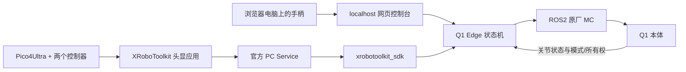

# Q1 与 Pico4Ultra 联调手册

当前实现基于官方开源协议，未知实际 Q1 固件、控制器版本及本体标定。明天先记录固件、SDK版本、机器人IP/网卡、ROS域号、控制电脑系统和手柄型号。`--diagnose` 只检查依赖，不表示已经连接。

## 1. 接线与软件



真机控制程序直接运行在宿主机，不使用Docker。控制电脑采用 Ubuntu22.04、ROS2 Humble、系统 Python3.10。台式x86_64或Orin/aarch64是绑定支持的平台；此前离线依赖验证只覆盖x86_64，现场宿主机仍需检查。Pico PC Service 与采集程序先放同一台控制电脑，头显与服务处于可互通网络；不要默认公网训练服务器能直接发现现场机器人。

保留 Q1 原厂 MC、原厂遥控器和独立物理急停。首版只订阅 HAL 状态，绝不发布 HAL 关节命令，也不关闭 MC。网页默认127.0.0.1；远程查看使用 SSH 转发。原生Pico遥操以Pico流和Grip作为运行保持条件；网页失焦会尝试发送停止，但网页网络断开不能替代Pico断流或独立急停。主机白名单与同源 token 用于阻止跨站误调用，不构成公网账号认证，**不要将真实控制台发布到公网**。

官方来源：

- [Q1 SDK 固定版本](https://github.com/PrimebotTech/primebot-q1-sdk/tree/7310314eee058323a2c15ab1f4f947df4112573e)，完整消息源码在 `vendor/primebot_sdk/aimdk_msgs`，保留原始声明和逐文件hash。
- [XRoboToolkit PC Service](https://github.com/XR-Robotics/XRoboToolkit-PC-Service)：安装适合主机架构的发行包，启动包内 `runService.sh`，同一主机只运行一份服务。
- [XRoboToolkit Unity Client](https://github.com/XR-Robotics/XRoboToolkit-Unity-Client)：在 Pico4Ultra 上安装相应头显应用，按上游说明连接PC Service，启用 Head 和 Controller tracking，并打开 Data & Control → Send。连接成功应显示WORKING；可用 Network → PC Service / Enter 手动填写PC服务IP。只使用头显和两个控制器，不要求Swift追踪器。
- [Python 绑定安装与 API](https://github.com/XR-Robotics/XRoboToolkit-PC-Service-Pybind/blob/8941e1dbbf4313fe83846f82984eaa8c992690bf/README.md)：`python3 -m pip install xrobotoolkit-sdk==1.1.0`。发行包与头显应用的具体兼容版本，现场先核对；本项目没有自行打包 APK。

## 2. 先做只读检查

先按 README“宿主机原生连接本体和 Pico”安装依赖、编译官方消息包，并用系统Python3.10建立 `.venv-ros`（带 `--system-site-packages`）。每个新终端先准备原生环境：

```bash
cd /data/kk/embodied_edge/q1
source /opt/ros/humble/setup.bash
source .ros_ws/install/setup.bash
source .venv-ros/bin/activate
```

下文的 `python3` 均指此虚拟环境中的Python3.10，不经过容器。与机器人同一 DDS 域和可互通网卡，PC与本体时间同步；消息头必须非零、持续推进且与ROS时钟相近，否则不能使能。默认 FastDDS 由官方消息包环境钩子启用，保留其UDP配置，排查网卡、防火墙和缓冲区时参照上游说明。

```bash
python3 -m q1_edge --backend ros2 --diagnose
ros2 topic list
ros2 service list
ros2 topic hz /aima/hal/joint/state --qos-reliability best_effort
ros2 service call /aimdk_5Fmsgs/srv/GetMcAction aimdk_msgs/srv/GetMcAction '{}'
ros2 service call /aimdk_5Fmsgs/srv/GetCurrentInputSource aimdk_msgs/srv/GetCurrentInputSource '{}'
```

应能收到完整关节状态和 MC 模式；上肢必须有全部10个关节。`GetMcAction` 返回 `header + info`，与其他服务 `response` 结构不同。本项目同时检查 RPC code、业务状态和最终 RUNNING 状态，RPC成功不等于模式已完成切换。

```bash
mkdir -p logs
test -e config/local.json || cp config/default.json config/local.json
python3 -m q1_edge --backend ros2 --enable-hardware \
  --config config/local.json --trace logs/hardware.jsonl
```

该进程初始仅查询/订阅，不注册控制源、不输出运动。页面应显示 ROS2、反馈新鲜和原厂实际模式。此时不要校准电机零位，本版本没有该接口。用原厂遥控器先将机器人准备为受保护的正常站姿；不要依赖未经验证的自动起身。

## 3. 手柄校准、使能和平衡站立

1. 浏览器选择“真实手柄”。核对所有轴/按钮，按Back前摇杆回中并松开RB。按键不匹配就修改本地配置，不带着未知映射行走。
2. Back完成中位校准，Start请求使能。成功使能才向MC添加 `edge_q1`，优先级默认30，低于原厂rc80；源只在内存中，重启后重注册。
3. 等待页面显示 `BIPED_WALK_RUN`、RUNNING且控制源有效。A为零速度平衡站立。官方 `BIPED_STAND_DEFAULT` 是无主动平衡的位置站立，本项目不把它用作平衡保持。
4. 若始终无法获得控制权，先检查原厂遥控器是否占用、同名源是否已存在和实际源优先级；不会自动删除别的同名实例，不通过提高优先级压过原厂遥控器。
5. 先测试B停止、网页失焦、松开RB、手柄断开后的归零和恢复步骤，再做小幅行走。

## 4. 最小行走

X进入行走，确认页面状态，再按住RB并轻推左摇杆。前后/横向/转向最大值为0.3/0.2/0.4，单位m/s、m/s、rad/s；官方小速度约束导致死区外最小非零量是0.2。初次一次只测一个轴，支撑方式、足底接触和测试场地遵守厂商要求。

松开RB立即发零速度，仍保留平衡；B停止同时取消本项目使能。多按钮同帧时停止优先。输入断流超过250ms、MC/关节反馈超过250ms、源被抢占均锁存停止，恢复后必须人工清故障、校准和再次使能，不自行续走。

## 5. 先让 Pico 只驱动 mock

启动 PC Service 与头显应用，在上游demo确认头和左右控制器都有数据，然后：

```bash
python3 -m q1_edge --backend mock --pico xrobotoolkit
```

页面选择真实手柄/原生Pico输入，**不要选择模拟输入同时覆盖原生帧**。无需另一个手柄也可以用页面按钮完成 Pico 校准、使能和模式选择；浏览器未检测到手柄时不会抢走原生Pico控制输入。先看输入年龄持续<250ms，左右Grip和头/手位置正常，然后松开Grip、面向机器人前方、双手舒适位置，校准→使能→遥操→同时握住两Grip，小幅移动。

校准把当前VR控制器位置与**当前实测关节**对应，不把手臂强行跳到HOME。手位置位移按Pico坐标转机器人：机器人X前、Y左、Z上，头部中立yaw用于固定航向。手臂4DOF以腕链接原点的位置为目标，控制器姿态只用于有效性/跳变检查；不是6D腕姿态复制。腰部相对头部yaw最多0.25rad、roll最多0.12rad。关节目标限速0.6rad/s；ROS适配层额外限速0.5rad/s。

松开任一Grip保持最后目标；再次握住会以当前位置重新对齐。目标不可达、跟踪大跳变、四元数无效、重复/倒序帧或数据中断会停并要求重新校准。SDK绑定没有每控制器跟踪有效标志，也没有原子快照；本实现用原生时间戳推进、读前后时间戳一致和数值/跳变检查减轻风险，**这不能证明遮挡时的跟踪正确**，明天必须实际测试遮挡和断网。

## 6. 确认上肢配置后再切真实遥操

当前 `config/default.json` 的限位来源是官方仿真模型，SDK文档另有不一致范围。保持 `upper.hardware_limits_confirmed=false` 直到确认：10关节名称顺序、角度单位、方向/零位、实际软硬限位、当前HOME与本固件匹配、CUSTOM_UPPER支持、20/3增益适合本体。当前代码没有任意轴反向/零偏转换层，若实测与模型坐标不一致，先修适配并重测，不能靠确认开关绕过。

在 `config/local.json` 写入确认的 `upper.limits`，再将 `hardware_limits_confirmed` 设true。以真实反馈重新校准，先原厂零速度平衡，再切CUSTOM_UPPER。切换由异步状态机完成，期间持续零速度、等RUNNING才发送全部10关节。下半身继续原厂MC平衡，本版不支持一边手柄行走一边Pico遥操。

```bash
python3 -m q1_edge --backend ros2 --enable-hardware --pico xrobotoolkit \
  --config config/local.json --trace logs/pico-hardware.jsonl
```

Pico只接入真实本机SDK采集；HTTP模拟Pico和模拟手柄均被ROS后端拒绝。首次双臂一两厘米和腰部极小角度，观察关节方向、速度、脚底和限位。IK只约束关节限位与可达性，**没有自碰撞/环境碰撞模型**；操作者不应将手臂交叉或逼近本体。

## 7. 停止与异常恢复

网页B/停止是软件停止，不切断电机电源，也不替代物理急停。行走时先持续零速度，确认平衡行走模式后删除本项目控制源。上肢遥操时先保持最后完整目标；只有10关节实测均在官方HOME±0.15rad内，才允许自动切回原厂行走零速度并释放源，避免直接切模式导致手臂跳变。

若上肢离HOME较远，界面会提示使用原厂遥控器恢复，此时保留源并保持上肢，不自动回HOME；退出进程是有界的，但无法保证本体已安全停止或源已删除。原厂遥控器抢占/外部切模式后本项目不再恢复模式，必须显式重新使能。**上肢保持、源超时以及原厂接管后的实际固件行为均待真机验证**。测试时原厂遥控器与物理急停必须独立可用。

常见问题：

|现象|优先检查|
|---|---|
|rclpy导入失败|用Ubuntu系统Python3.10，source Humble，勿覆盖PYTHONPATH|
|aimdk_msgs缺失|编译vendor完整包并source install/setup.bash|
|有topic但不能使能|全部10关节、非零推进时间戳、PC/机器人时钟、反馈年龄、模式RPC|
|源已存在/无法获取控制权|重复进程、原厂rc抢占、唯一源名；不要自动删除未知源|
|真实后端拒绝输入|浏览器切真实手柄，Pico必须用--pico xrobotoolkit|
|上肢模式被阻止|实际固件/限位/零位待确认，不能直接绕过配置开关|
|Pico连接但目标不动|双Grip≥0.7、模式RUNNING、输入新鲜、已校准、源有效|
|unreachable|手臂工作空间受限，停止/松Grip、回到可达小位移、清故障重新校准|

日志保存命令、状态、输入年龄和模式；不记录视频。联调时另行记录固件、配置版本、时钟、启动日志和每项实际结果，再决定扩大运动范围。
