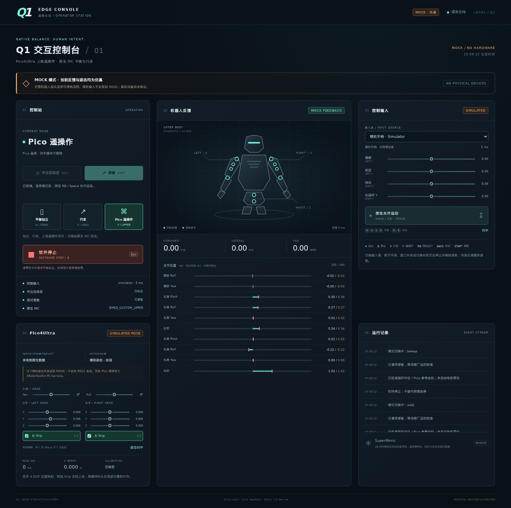

# 验证记录（2026-10-30）

交付目录 `/data/kk/embodied_edge/q1`。用户已指定真机交互采用宿主机原生运行；本页Docker结果仅是此前离线测试记录，不代表原生宿主机已完成ROS安装或设备联调。没有本体、手柄或 Pico 设备；以下是软件、模拟输入和隔离通信验证，不能代替实机测试。没有 git 提交。

## 已运行

|验证|结果与范围|
|---|---|
|Python unittest|73/73通过：ROS后端26、控制状态机19、Pico19、HTTP边界9；在交付目录运行|
|Node界面行为与语法|`node tests/check_ui.cjs` 与 `node --check q1_edge/web/app.js` 通过|
|真实 Chromium 操作链路|校准→使能→行走→RB保持→松开归零→停止→Pico校准/遥操→双Grip→手移动→Grip松开保持→失焦停；无JS错误|
|Pico模拟收敛|从SDK官方HOME左手向上35mm，最终位置误差0.000101563m（约0.102mm）；这是纯运动学与mock，不是本体误差|
|界面尺寸|1600×1100桌面和390×844手机，无横向溢出；截图见本页下方|
|官方ROS消息包|固定SDK提交7310314eee058323a2c15ab1f4f947df4112573e，完整aimdk_msgs在Ubuntu22.04 / Humble镜像中colcon编译成功|
|Pico镜像与原生绑定|`embodied-q1:pico`构建成功；Python3.10.12实际import xrobotoolkit_sdk成功，8个所需API均存在；--diagnose四项依赖全部可用。未调用SDK init或连接PC Service|
|真实ROS2 DDS|`--network none`、域117、ROS_LOCALHOST_ONLY=1，真实rclpy/generated messages与假MC服务节点回环通过|
|DDS验证内容|启动只读、显式注册源、获得控制权、50Hz速度心跳、模式确认、上肢完整10关节/20-3增益、停止保平衡并释放源、关节反馈断流看门狗|
|SDK与FK来源|vendor62文件均保留Git blob/SHA256，FK树有单独SHA256与来源许可；校验应与provenance一致|

基础镜像固定摘要 `ros:humble-ros-base-jammy@sha256:d9bcf2e6f72df127fdee07048c2e87b1b4b9a59a74af0592f4489fc2844aa855`。Docker产物为本机镜像，不是公网发布。

Pico首次从files.pythonhosted.org下载因网络超时失败；使用可配置公开镜像后构建通过。x86_64 wheel为`xrobotoolkit_sdk-1.1.0-cp310-abi3-manylinux_2_34_x86_64.whl`，SHA256 `ec8ce525110cfa742b901f8f43b4429692b1e825f1586903499732218fab3a89`，已与官方PyPI JSON元数据核对一致。

## 多轮检查与修正

1. **协议检查**：纠正“位置站立即平衡”的假设，采用WALK_RUN零速度；模式切换检查最终RUNNING，保持原厂MC；上肢每帧完整10关节。
2. **运动学检查**：校准使用实测关节，不跳到固定HOME；SDK正肘HOME向前35mm不可达，独立24组初值/无中立偏置参考求解和最大臂长计算均确认至少4.951mm残差，未放宽阈值掩盖问题；补正常可达方向测试。
3. **独立集成审查**：复现并修复同帧“停止+使能”导致重新使能、原厂遥控抢占后stop重新激活自动模式恢复两项问题，均先失败回归再修复，复核通过。
4. **真实浏览器检查**：修正页面刷新导致模拟Pico时间戳回退；补输入所有者更换撤销校准和HTTP操作身份校验。等待手部目标实际收敛，而不是仅检查关节开始变化。

## 可复跑

```bash
cd /data/kk/embodied_edge/q1
python3 -m unittest discover -s tests -v
node tests/check_ui.cjs
node --check q1_edge/web/app.js
# 默认mock服务运行后；Playwright是可选的验收依赖，不是程序运行依赖。
python3 scripts/check_browser.py http://127.0.0.1:8766/
```

浏览器脚本依赖 Playwright + Chromium；先安装到独立测试环境。脚本会验证backend必须是mock，输出到 `/tmp/edge-q1-browser`，不应对真实后端执行。DDS自检的隔离Docker命令见README。



[手机尺寸截图](screenshots/mobile.png) · [浏览器结果JSON](browser-result.json)

## 未验证与明天待办

- 实际Q1固件/网卡/DDS域/时钟同步、10关节软硬限位/方向/零位、MC切换和源超时的固件行为。
- Pico4Ultra应用与PC Service兼容版本、头显遮挡/断网/跟踪丢失、真实手柄映射和无线延迟。
- 实机平衡、站立、步态、上肢20/3增益、自碰撞、物理急停与原厂接管/恢复；UI与IK不提供这些结果的保证。
- 上肢远离HOME时软件停止不会自动切回行走；保守保持和原厂遥控器接管流程需要现场验证。
- SuperMimic推理与低层真机执行尚未接入；本版本没有相机视频、手指控制或全身动捕。
